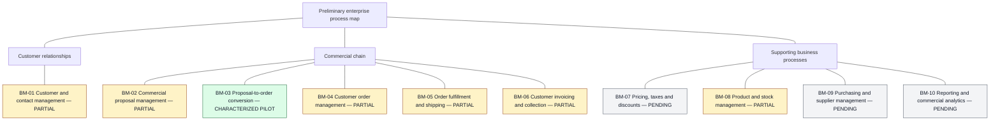
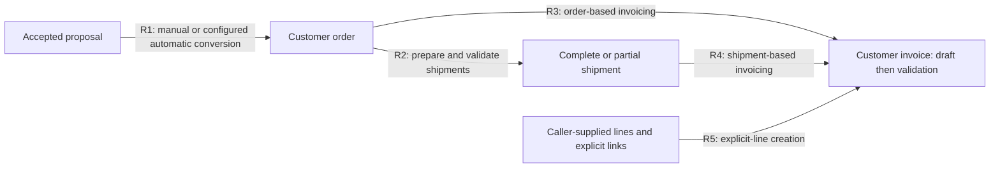

# Global Business Process Map

## Purpose and reading guide

`ALIXAR-MAP-001` connects the preliminary [inventory](INVENTORY.md), AFS and six
descriptive AS-IS BPMN maps. It is navigation, not a complete reconstruction of
Dolibarr, an approved roadmap, an Alixar contract or an executable process.
No new legacy behavior is characterized here.

The reference remains Dolibarr **24.0.1**, source commit
`b7958385f00a92219f76a4dfea67dae93df97a25`. Commercial, shipping and invoicing
profiles have different configurations and observation boundaries. Connecting
their documents does not prove one end-to-end execution.

Coverage and evidence are separate dimensions:

- **Characterized pilot**: a bounded process has runtime evidence and BPMN;
  untested variants remain open.
- **Partial**: selected operations or effects have evidence, not the whole
  macroprocess lifecycle.
- **Pending**: no characterization of the macroprocess in this inventory.
- `DEMOSTRADO`: observed at runtime within the cited fixture boundary.
- `INFERIDO`: source-derived behavior or interpretation requiring verification.
- `PENDIENTE`: missing evidence; no dependency may be assumed from it.

## Macroprocess hierarchy

Lines mean **decomposition/navigation only**, never execution order. Grouping
is editorial, not a new business rule. Text carries coverage independently of
color. The catalogue below provides links without interactive Mermaid features.

| Macroprocess | Characterized boundary and navigation | Remaining coverage |
|---|---|---|
| BM-01 | Selected observations in [ThirdParty](https://github.com/alxarafe/dolibarr-reference/blob/a69836e535688b08f6a4a30e7d200b3ad4c43870/reference/characterization/THIRDPARTY-REF-001-thirdparty-lifecycle.md) and [Contact](https://github.com/alxarafe/dolibarr-reference/blob/a69836e535688b08f6a4a30e7d200b3ad4c43870/reference/characterization/CONTACT-REF-001-contact-lifecycle.md); [operation example](../functional/examples/AFS-TP-001-thirdparty-create.md), [process example](../functional/examples/AFS-PROC-001-thirdparty-contact.md) | Overall framing `INFERIDO`; relationship lifecycle incomplete; no dedicated BPMN |
| BM-02 | Selected proposal creation, lines, validation and acceptance in [proposal characterization](https://github.com/alxarafe/dolibarr-reference/blob/a69836e535688b08f6a4a30e7d200b3ad4c43870/reference/characterization/PROPAL-ORDER-REF-001-proposal-to-order.md) and [audit follow-up](https://github.com/alxarafe/dolibarr-reference/blob/a69836e535688b08f6a4a30e7d200b3ad4c43870/reference/characterization/PROPAL-ORDER-REF-001-audit-follow-up.md); [AFS-PROC-002](../functional/AFS-PROC-002-proposal-to-order.md) | Wider lifecycle `PENDIENTE`; source-only refusal/closing behavior `INFERIDO` |
| BM-03 | `DEMOSTRADO` manual/automatic conversion in scoped fixtures; R1, B1/B2 below | Browser/signature, general cardinality, concurrency and rollback `PENDIENTE` |
| BM-04 | Selected creation/validation and shipping/closure states; R1/R2/R3, [AFS-PROC-003](../functional/AFS-PROC-003-order-to-shipment.md) | Wider order lifecycle, cancellation/deletion `PENDIENTE` |
| BM-05 | `DEMOSTRADO` complete/partial/successive shipment pilot; R2, B3 | Physical receipt and full logistics `PENDIENTE`; UI guards `INFERIDO` |
| BM-06 | Standard invoice creation/validation with three business inputs; R3/R4/R5, B4/B5/B6 | Payments, collection, credit notes and automated/grouped routes `PENDIENTE` |
| BM-07 | `PENDIENTE`; [inventory](INVENTORY.md#1-business-macroprocesses) | Priced-line observations do not characterize pricing/tax/discount rules |
| BM-08 | Selected shipping and invoicing stock effects; R6/R7, [shipping stock rules](../functional/AFS-PROC-003-order-to-shipment.md#7-stock-rules-and-configuration), [invoice effects](../functional/AFS-PROC-004-customer-invoicing.md#9-events-effects-and-dependencies) | Broader product/warehouse/stock management `PENDIENTE`; no standalone BPMN |
| BM-09 | `PENDIENTE`; [inventory](INVENTORY.md#1-business-macroprocesses) | Purchasing/supplier characterization missing |
| BM-10 | `PENDIENTE`; [inventory](INVENTORY.md#1-business-macroprocesses) | Reporting/analytics characterization missing |

## Commercial chain

Arrows show **available transformations of business inputs**, not mandatory
sequence flows, automatic dispatch or exclusive alternatives. R1–R5 are
`DEMOSTRADO` within their individual evidence boundaries below. The combined
arrangement is an `INFERIDO` navigation synthesis; a full-chain runtime scenario
remains `PENDIENTE`.

An order need not originate in a proposal. Order-based invoicing does not acquire
a shipment prerequisite from this drawing. Shipment-based invoicing copies
shipment quantities and retains links to shipment and order. R3/R4/R5 are inputs,
not a demonstrated mutually exclusive choice. R5 supplies its own lines and
order link; a document link does not prove source-line conversion.

Draft creation and validation are distinct. R1 can leave a draft, so its output
is not automatically eligible for R2/R3. Downstream pilots use their own eligible
orders. No general proposal-to-invoice link, automatic handoff, universal
duplicate prevention, residual-quantity guard or payment transition is asserted.
See [proposal/order relationships](../functional/AFS-PROC-002-proposal-to-order.md#43-relationships)
and [invoice relationships](../functional/AFS-PROC-004-customer-invoicing.md#42-relationships-and-structural-limits).

## Process relationships

Labels qualify each stated relationship, not the entire macroprocess. Inputs
and outputs are business documents/effects, not endpoints or harness activities.
B1–B6 resolve to the [navigation table](#bpmn-and-evidence-navigation).

| ID / relationship | Business input | Output / documents | Evidence and limits |
|---|---|---|---|
| R1 · BM-02 → BM-03 → BM-04 | Accepted proposal and lines; manual selection or configured automatic conversion | Linked draft order; later/configured immediate validation may succeed; proposal → order | `DEMOSTRADO`: [audit outcomes](https://github.com/alxarafe/dolibarr-reference/blob/a69836e535688b08f6a4a30e7d200b3ad4c43870/reference/characterization/PROPAL-ORDER-REF-001-audit-follow-up.md#observed-outcomes), [AFS-PROC-002 scenarios](../functional/AFS-PROC-002-proposal-to-order.md#11-test-scenarios), B1/B2. Controlled HTTP UI/manual and automatic fixtures. Empty selection differs from cancel; no global uniqueness guarantee |
| R2 · BM-04 → BM-05 | Eligible order lines, selected quantities and warehouse | Draft, validated and closed shipments; complete/successive partial fulfillment; order → shipment and source-line relationships; conditional order closure | `DEMOSTRADO`: [shipping characterization](https://github.com/alxarafe/dolibarr-reference/blob/a69836e535688b08f6a4a30e7d200b3ad4c43870/reference/characterization/ORDER-SHIPMENT-REF-001-order-to-shipment.md), [AFS-PROC-003 scenarios](../functional/AFS-PROC-003-order-to-shipment.md#10-scenarios-and-traceability), B3. Administrator class mutations; UI guards `INFERIDO`, positive API mutations `PENDIENTE`. Zero remaining alone does not close the order |
| R3 · BM-04 → BM-06 | Tested validated order; full quantities, percentage or selected original lines | Draft then validated standard invoice; order → invoice | `DEMOSTRADO`: [invoice quantities](https://github.com/alxarafe/dolibarr-reference/blob/a69836e535688b08f6a4a30e7d200b3ad4c43870/reference/characterization/INVOICE-ROUTES-REF-001-invoicing-routes.md#observed-quantities-duplicates-and-states), AFS-PROC-004 TEST-001–004, B4. Full copy via form/API/class; percentage/selection via form only. Repeated creation can copy original quantities again |
| R4 · BM-05 → BM-06 | Tested validated partial shipment and quantities | Draft then validated invoice; shipment → invoice and order → invoice; order → shipment retained | `DEMOSTRADO`: [persisted relationships](https://github.com/alxarafe/dolibarr-reference/blob/a69836e535688b08f6a4a30e7d200b3ad4c43870/reference/characterization/INVOICE-ROUTES-REF-001-invoicing-routes.md#persisted-relationships), AFS-PROC-004 TEST-005/009, B5. Controlled form creation/API validation; repeat copies shipment quantities again |
| R5 · Explicit-line creation within BM-06 | Caller-supplied line and explicit order link | Draft then validated invoice with supplied line; explicit order → invoice link | `DEMOSTRADO`: INV-ROUTE-005 in [route matrix](https://github.com/alxarafe/dolibarr-reference/blob/a69836e535688b08f6a4a30e7d200b3ad4c43870/reference/characterization/INVOICE-ROUTES-REF-001-invoicing-routes.md#route-matrix), AFS-PROC-004 TEST-006/010, B6. No automatic conversion; generic-origin validation denial `INFERIDO`, that runtime variant `PENDIENTE` |
| R6 · BM-05 ↔ BM-08; BM-05 → BM-04 | Shipment validation, closure or tested cancellation; configured timing | Conditional stock movements/compensation and order state effects; shipment/order source documents | `DEMOSTRADO`: [shipping stock rules](../functional/AFS-PROC-003-order-to-shipment.md#7-stock-rules-and-configuration), TEST-001–005/010/011, B3. Three timing modes for successive partials; full shipment validation timing only; four sequential repeated closes. No universal restock/concurrency claim |
| R7 · BM-06 → BM-08 | Invoice validation; independent stock configuration and warehouse | Conditional invoice-origin stock movement, possibly alongside shipment-origin movement | `DEMOSTRADO`: [stock attribution](https://github.com/alxarafe/dolibarr-reference/blob/a69836e535688b08f6a4a30e7d200b3ad4c43870/reference/characterization/INVOICE-ROUTES-REF-001-invoicing-routes.md#stock-attribution), AFS-PROC-004 TEST-007–009, B4/B5. One combined double decrement; no configuration recommendation or Alixar policy approval |

## BPMN and evidence navigation

Follow **macroprocess → relationship → BPMN → AFS → characterization/capture**.
AFS traceability identifies individual steps, effects and inferred/pending paths.
Rendering does not establish functional fidelity. Evidence links open directly
on GitHub and are pinned to `dolibarr-reference` documentation/evidence commit
`a69836e535688b08f6a4a30e7d200b3ad4c43870`, independently of local checkout layout.
This repository revision is distinct from the Dolibarr source commit above.
For offline reading, use the same `reference/characterization/` paths in a local
checkout of that reference revision. Catalogue and table links work without
interactive Mermaid features.

| Key / macroprocess | BPMN | AFS traceability | Runtime authority |
|---|---|---|---|
| B1 · BM-03, BM-02/04 boundary | [Manual proposal → order](PROC-SLS-001-ASIS-MANUAL.bpmn) | [AFS-PROC-002 §12](../functional/AFS-PROC-002-proposal-to-order.md#12-traceability) | [Proposal characterization](https://github.com/alxarafe/dolibarr-reference/blob/a69836e535688b08f6a4a30e7d200b3ad4c43870/reference/characterization/PROPAL-ORDER-REF-001-proposal-to-order.md), corrected/extended by [audit follow-up](https://github.com/alxarafe/dolibarr-reference/blob/a69836e535688b08f6a4a30e7d200b3ad4c43870/reference/characterization/PROPAL-ORDER-REF-001-audit-follow-up.md) |
| B2 · BM-03, BM-02/04 boundary | [Automatic proposal → order](PROC-SLS-001-ASIS-AUTOMATIC.bpmn) | [AFS-PROC-002 §12](../functional/AFS-PROC-002-proposal-to-order.md#12-traceability) | Same proposal characterization and audit as B1; creation and validation boundaries remain distinct |
| B3 · BM-04/05/08 | [Order → shipment](PROC-SHP-001-ASIS-ORDER-SHIPMENT.bpmn) | [AFS-PROC-003 §10](../functional/AFS-PROC-003-order-to-shipment.md#10-scenarios-and-traceability) | [Shipping characterization](https://github.com/alxarafe/dolibarr-reference/blob/a69836e535688b08f6a4a30e7d200b3ad4c43870/reference/characterization/ORDER-SHIPMENT-REF-001-order-to-shipment.md), [current 28-observation capture](https://github.com/alxarafe/dolibarr-reference/blob/a69836e535688b08f6a4a30e7d200b3ad4c43870/reference/characterization/ORDER-SHIPMENT-REF-001-observed-2026-11-08.json) |
| B4 · BM-04/06/08 | [Order → invoice](PROC-INV-001-ASIS-ORDER.bpmn) | [AFS-PROC-004 §11](../functional/AFS-PROC-004-customer-invoicing.md#11-bpmn--afs--evidence-traceability) | [Invoice characterization](https://github.com/alxarafe/dolibarr-reference/blob/a69836e535688b08f6a4a30e7d200b3ad4c43870/reference/characterization/INVOICE-ROUTES-REF-001-invoicing-routes.md), [27-observation capture](https://github.com/alxarafe/dolibarr-reference/blob/a69836e535688b08f6a4a30e7d200b3ad4c43870/reference/characterization/INVOICE-ROUTES-REF-001-observed.json); INV-ROUTE-001/002/003 |
| B5 · BM-05/06/08 | [Shipment → invoice](PROC-INV-001-ASIS-SHIPMENT.bpmn) | [AFS-PROC-004 §11](../functional/AFS-PROC-004-customer-invoicing.md#11-bpmn--afs--evidence-traceability) | Same invoice characterization/capture; INV-ROUTE-004 |
| B6 · BM-06 | [Explicit invoice lines](PROC-INV-001-ASIS-EXPLICIT.bpmn) | [AFS-PROC-004 §11](../functional/AFS-PROC-004-customer-invoicing.md#11-bpmn--afs--evidence-traceability) | Same invoice characterization/capture; INV-ROUTE-005 |

## Documentary discontinuities and open boundaries

- **Integration versus review:** AFS-PROC-002 retains `status: draft` despite its
  correction record; AFS-PROC-003 has `status: reviewed`; AFS-PROC-004 explicitly
  records pending human acceptance and `status: draft`. Integration alone does
  not authorize changing these fields or normative content. The [invoicing
  validation report](ALIXAR-REF-005-validation.md) is historical evidence and
  retains its pending-review statements.
- **Coverage versus status:** inventory draft references concern AFS review,
  not absence of integrated maps or runtime observations. BM-05 is partial
  because the pilot is not all logistics; BM-06 is not invoice-to-cash coverage.
- **Composition gap:** cardinality, cross-process transactions, duplicate
  prevention and end-to-end automation require separate evidence and explicit
  decisions. No ALIXAR-REF-006 scope is opened here.
- **Evidence history:** the earlier 21-observation shipping capture is historical;
  navigation here targets the corrected 28-observation capture. Evidence and
  pinned source traces retain their respective authority.
- **Unmapped areas:** BM-07/09/10 lack characterizations here; BM-01 examples are
  not dedicated BPMN maps. Missing coverage does not imply business dependencies.

See [GitHub Mermaid support](https://docs.github.com/en/get-started/writing-on-github/working-with-advanced-formatting/creating-diagrams),
[Mermaid flowchart syntax](https://mermaid.js.org/syntax/flowchart.html) and
[BPMN visualization](README.md#visualización-de-procesos).
